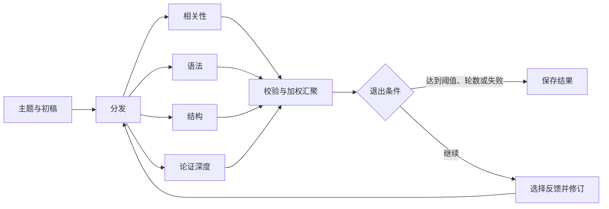

# Eassy Loop

基于 LangGraph 的英文文本评测与反馈修订框架。将相关性、语法、结构、论证深度拆成四个裁判节点，汇聚结构化判断后修订文本，并记录每轮内容、调用延迟和 Token 用量。

使用进程内多角色编排，不包含标准 A2A 通信协议。

## 主要功能

- 四维裁判支持并行 fan-out/fan-in 和串行执行；汇聚时校验轮次与文章哈希。
- Pydantic 校验评分 JSON、分数范围和字段；引用必须是原文子串，失败不填默认分。
- 支持总分阈值、单维最低分和固定轮数；保存实际反馈及修订前后文本。
- 提供不重写、无反馈重写、相关性反馈、全维反馈四组消融。
- HTTPX 连接池复用，区分鉴权、网络、超时和响应截断；批次遇到服务故障暂停。
- 调用前记录任务标记、逐请求落盘，显式续跑只处理尚未开始的任务；预算包含失败尝试。
- Token 读取服务端 usage，缺失保留 null；费用计算要求另行提供适用价表。



## 快速开始

Python 3.13；在项目根目录执行：

```powershell
python -m venv .venv
.venv/Scripts/python -m pip install -r requirements-lock.txt
.venv/Scripts/python -B -m src --demo --max-rounds 2 --stop-policy fixed
.venv/Scripts/python -B -m pytest -q -p no:cacheprovider
```

Linux/macOS 使用 .venv/bin/python。demo 使用脚本假模型，不联网，也不代表质量实验结果。

真实调用前，将 .env.example 复制为 .env，填入自己的 DASHSCOPE_API_KEY，确认 QWEN_BASE_URL 与账户区域对应。不要把密钥写入代码、提示或样本。进程已有同名环境变量时优先使用环境值，刷新方法见[终端配置](docs/TERMINAL_ENV.md)。

```powershell
.venv/Scripts/python -B -m src --topic "Should cities reduce private car use?" --model qwen-plus --max-rounds 2 --max-attempts 1 --stop-policy fixed
```

模型标识及访问权限由服务账户决定。真实调用会产生费用；本项目不会默认执行实验或自动更换模型。

PyCharm 配置：打开项目根目录，解释器选择 .venv/Scripts/python.exe，Module name 填 src，Working directory 选项目根目录，Parameters 先填 --demo --max-rounds 2 --stop-policy fixed。项目可以放在任意目录，运行时以仓库根目录为工作目录。

## 常用参数

|参数|含义|
|---|---|
|--mode evaluate / optimize|单次评分 / 反馈修订|
|--essay-file|已有初稿；evaluate 模式必填|
|--execution parallel / serial|四维裁判拓扑|
|--feedback-mode all / relevance / none|重写器可见的反馈|
|--stop-policy threshold / fixed|阈值退出 / 固定轮数|
|--max-rounds|评测轮数，含初稿；两轮只重写一次|
|--max-attempts|每节点总尝试数，包含首次请求|
|--timeout|HTTP 网络阶段超时，不是工作流总时限|
|--output-dir|新的输出目录，拒绝覆盖已有结果|

默认输出 runs/<run_id>/，包含 result.json、summary.json、calls.jsonl、final_essay.txt 和 manifest.json。生成调用成功与文本实际改变分别统计；分数上涨也不等于客观质量提高。

## 已有实验

[实验协议](docs/DUAL_MODEL_V2.md) · [运行与复算](docs/REPRODUCIBILITY.md)

2026-11-16 至 17 日，在 10 篇多主题合成英文初稿上执行四组固定两轮消融。40 个工作流中 31 成功、9 失败；第二模型对 34 篇去重文本评分，33 成功、1 次输出截断。共记录 320 次请求尝试，包括失败请求。

主比较为同初稿的“全维反馈－无反馈”，有效配对 6，失败配对 4：

|裁判请求标识|改善 / 持平 / 退化|平均分差|探索性 95% bootstrap 区间|
|---|---|---:|---|
|qwen3.8-27b|6 / 0 / 0|+0.0232|[+0.0110, +0.0393]|
|kimi-k3|2 / 0 / 4|−0.0092|[−0.0283, +0.0108]|

两种裁判对改进方向有分歧，现有结果不支持“全反馈稳定优于无反馈”。两模型对 10 篇原稿的加权总分 MAE 为 0.1031，Spearman 为 0.9848，衡量模型分歧与排序一致性，不是准确率。

样本全部为 AI 编写的开发集文本，没有人工真值或独立测试集；每组仅一次修订。第一模型分维调用，第二模型联合评分，模型与提示布局存在混杂。没有串并行控制实验，不报告加速比；5 次请求缺少 usage，也没有适用价表，不报告完整 Token 总量或货币成本。

## 代码与测试

```text
src/app.py            图编排、运行入口
src/nodes.py          生成、四维判断、反馈与退出
src/schemas.py        输入与结果契约
src/client.py         模型适配、连接池与错误分类
src/telemetry.py      线程安全调用记录
src/dual_study.py     双模型消融、预算与续跑
src/experiments.py    稳定性、消融和效率实验工具
src/network_guard.py  网络预检、运行日志
src/metrics.py        MAE、Spearman、标准差、bootstrap
src/artifacts.py      结果归档与源码指纹
tests/                禁止联网的单元及集成测试
```

精简分发文件后，从干净检出通过 152 项离线测试。GitHub Actions 检查源码文件完整性并运行离线测试，不依赖本地结果目录。历史批次的源码快照、日志和完整报告仅保存在本地，不随代码提交；上文数值为该批次的探索性摘要。评分标准沿用 essayloop-rubric-v3 标识。

更多说明：[架构](docs/ARCHITECTURE.md)、[实验工具](docs/EXPERIMENTS.md)、[双模型协议](docs/DUAL_MODEL_V2.md)。人工标注接口保留为可选工具，当前实验未使用。仓库包含运行源码、测试、依赖和固定样本；简历材料、发布记录、原始调用日志和历史源码副本均在本地保存。
